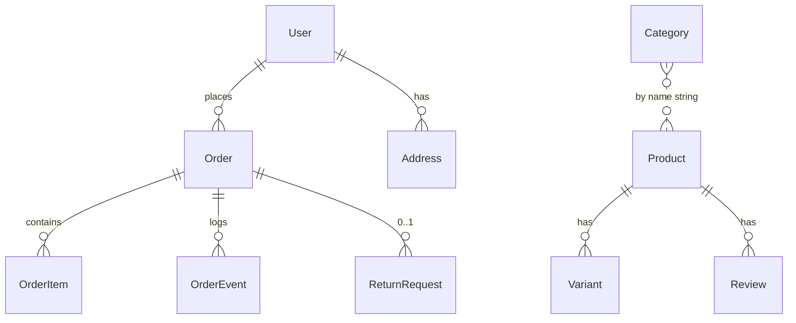
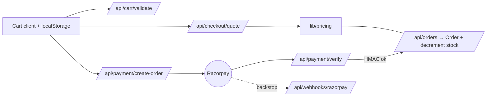

# AAKAR-WEB — Project Guide & Architecture Map

> This file is the permanent map of the codebase. Trust it to locate files **without re-scanning**.
> If something here no longer matches the code, fix the code reference AND update this map in the same change.

---

## 🔒 UI ONLY RULE (strict, permanent)

> **When improving UI/UX, modify ONLY visual styling, CSS, Tailwind classes, and layout. NEVER alter business logic, state, props, APIs, or backend code.**

Concretely, a "UI/UX improvement" may touch: Tailwind/`className` values, `app/globals.css`, layout/markup structure, CSS animations/keyframes, design tokens, and presentational wrapper components. It must **not** change: React state or hooks behavior, component prop shapes/contracts, event-handler logic, data fetching, `lib/**`, `app/api/**`, `prisma/**`, auth, pricing, or any server code. If a visual change seems to require a logic change, **STOP and ask first**.

---

## Stack

- **Next.js 15** (App Router, RSC) · **React 19** · **TypeScript** · **Tailwind CSS v4** (`@tailwindcss/postcss`)
- **Prisma** + **PostgreSQL** · **NextAuth** (credentials + TOTP 2FA) · **Razorpay** (payments) · **Cloudinary** (images) · **Nodemailer** (email) · **pdfkit**/**qrcode** (invoices/labels) · **zod** (validation)
- Scripts: `dev`, `build`, `typecheck` (`tsc --noEmit`), `deploy-build` (`prisma migrate deploy && next build`), `db:migrate`, `db:seed`, `db:demo`, `test:e2e`.
- **Deploy:** Vercel, production branch = `main`, project `aakar-web-k1zu` (prod URL `https://aakar-web-k1zu.vercel.app/`). `vercel.json` sets build command to `deploy-build` so migrations apply on deploy.

> Local note: this EC2 box's `node_modules` is often broken (Prisma client not generated) → `tsc` shows env-only `implicit any` / `@prisma/client` noise. Vercel builds clean. Verify touched files have **no NEW** errors beyond that baseline.

---

## Directory layout (top level)

```
app/            Routes (App Router): (store) storefront, admin, auth pages, api/
components/     React components: storefront (root), admin/, ui/ primitives
lib/            Business logic & server helpers (pricing, auth, mail, prisma, …)
prisma/         schema.prisma + migrations/ + seeds
middleware.ts   Protects /admin/** (role=admin, optional 2FA gate)
next.config.ts  Security headers (CSP report-only), image config
app/globals.css Design system: tokens, .btn/.chip/.card, utilities, keyframes
app/layout.tsx  Root layout — injects admin-editable brand tokens onto <body>
```

---

## Route map (pages → file paths)

### Storefront — `app/(store)/` (wrapped by `app/(store)/layout.tsx` = Header + Footer + providers)
```
/                      (store)/page.tsx            Home: hero (BannerSlider OR HeroEditorial fallback) + category grid + new arrivals
/products              (store)/products/page.tsx   Catalog (filters by category/search)
/products/[id]         (store)/products/[id]/page.tsx  PDP: gallery, add-to-cart, reviews, size chart
/cart                  (store)/cart/page.tsx       Cart (client; CartProvider + localStorage)
/checkout              (store)/checkout/page.tsx   Checkout → quote → Razorpay
/wishlist              (store)/wishlist/page.tsx   Wishlist (WishlistProvider)
/orders, /orders/[id]  (store)/orders/...          Order history + detail
/account               (store)/account/page.tsx    + ProfileForm, PasswordForm, AddressBook, PrivacyForm
/track/[token]         (store)/track/[token]/page.tsx  Public order tracking by token
/[slug]                (store)/[slug]/page.tsx      CMS pages (Page model) + ContactForm
/return-policy         (store)/return-policy/page.tsx
```

### Admin — `app/admin/` (wrapped by `app/admin/layout.tsx`; protected by `middleware.ts`)
```
/admin                 admin/page.tsx              Dashboard (Charts)
/admin/products        + products/new, products/[id], ProductForm.tsx
/admin/categories, /admin/banners, /admin/coupons, /admin/pages (+ [slug])
/admin/orders (+ [id], orders/[id]/label = shipping label w/ QR)
/admin/customers (+ [id]), /admin/returns, /admin/reviews
/admin/sales, /admin/low-stock, /admin/activity (audit log)
/admin/settings        Branding/theming, couriers, etc.
/admin/security        2FA setup/disable/recovery
```

### Auth & standalone (outside store/admin layouts)
```
/login /register /forgot-password /reset-password /verify-email   (each has page.tsx + a *Form/*Client client component)
/invoice/[id]          invoice/[id]/page.tsx + PrintButton + pdf/route.ts (PDF)
app/layout.tsx (root), app/providers.tsx (SessionProvider etc.), app/robots.ts, app/sitemap.ts
app/error.tsx, app/global-error.tsx, app/not-found.tsx
```

---

## API map — `app/api/**/route.ts` (grouped)

```
auth/        [...nextauth], register, forgot-password, reset-password, verify-email, resend-verification
account/     profile, password, addresses(+[id]), delete, export            (self-service, requireUser)
cart/        validate                                                        (reconcile stale localStorage cart)
checkout/    quote                       → lib/pricing  (preview totals)
payment/     create-order, verify        → Razorpay + HMAC (lib/crypto, lib/razorpay)
orders/      route (create), [id]/cancel → lib/pricing, lib/stock
returns/     route                        (one ReturnRequest per order; refund guard)
reviews/, wishlist/, contact/, pincode/, products(+[id])
webhooks/    razorpay                     (payment backstop, HMAC-verified)
cron/        expire-orders               → lib/expiry (release stock on unpaid orders)
admin/       products, categories, banners, coupons, orders(+[id],export), customers(+export),
             returns(+[id]), reviews(+[id]), pages/[slug], variants/[id], settings, upload (Cloudinary),
             low-stock, activity, security/(setup|enable|disable|recovery)   (all requireAdmin)
invoice/[id]/pdf
```
Guards: `lib/requireUser.ts`, `lib/requireAdmin.ts`, `lib/orderAccess.ts` (owner | admin | token). Params typing: `lib/api.ts` (Next 15 Promise params). Validation: `lib/schemas.ts` (zod).

---

## Components (`components/`)

```
Storefront (root):
  Header, HeaderActions, MobileMenu, Footer            Chrome / nav
  BannerSlider      Homepage hero carousel (admin banners) — VISUALLY polished, logic locked
  HeroEditorial     No-banner fallback hero (image + serif headline + CTA)
  ProductCard, ProductGallery, Photo, Price            Product display (Photo wraps Cloudinary via lib/img)
  AddToCart, CartProvider  (cart state + localStorage)
  HeartButton, WishlistProvider                        Wishlist
  Reviews, ReviewForm · SizeChart · PincodeCheck · StateSelect
  OrderView, OrderActions, ReturnForm, PrintButton
  WhatsAppButton · ConsentAnalytics, CookieSettings    FAB / consent

admin/ : AdminNav (sidebar + mobile drawer), Charts, DataTable, ExportOrders, StatusBadge
ui/    : Button (ButtonLink + variants), Card, Badge, fields (TextField/ColorField/ImageField/FormMessage)
```
Shared form plumbing: `lib/hooks.ts` (`useForm`, `useAction`) + `components/ui/fields.tsx` `FormMessage` (role=alert/status). Client data fetch: `lib/fetcher.ts`.

---

## Data model (Prisma) — `prisma/schema.prisma`



- **User** — role (customer/admin/guest/deleted), bcrypt password, `sessionVersion` (force-logout), TOTP 2FA (`totpSecret` encrypted, `recoveryCodes` hashed), `emailVerified`.
- **Product** — price in paise (Int), `images[]`, `category` (string → Category.name, not FK), `gstRate`/`hsnCode`; **Variant** (size/color/stock).
- **Category** — unique name, `active` (inactive ⇒ products not for sale), `position`, `sizeChart`.
- **Order** — status, `paymentMethod`, money fields in paise (subtotal/shipping/discount/codFee/total), `razorpayOrderId`/`razorpayPaymentId`, shipping+GST state, tracking; `accessToken` (guest link), `invoiceNo` (autoincrement). **OrderItem** (snapshotted name/price/gst), **OrderEvent** (status history).
- **ReturnRequest** — `@@unique([orderId])` = one per order (blocks double-refund race).
- **Coupon** — type/value/minOrder/maxDiscount/usage + perUserLimit/usedCount.
- **Banner** — imageUrl/title/subtitle/buttonText/linkUrl/position/active/starts-ends (drives BannerSlider).
- **Review** (`@@unique([productId,userId])`, status pending/approved), **Wishlist** (`@@unique([userId,productId])`), **Page** (CMS slug), **Address**.
- **Auth/infra:** PasswordReset, EmailVerification, RateLimit, AuditLog.
- **SiteSettings** — single row; **all branding is admin-editable**: siteName, tagline, logoUrl, primary/secondary/accent/background/surface/text/border colors, announcement, couriers, etc.

---

## Key flows

**Checkout → payment (money = `lib/pricing.ts`, the single source of truth):**

`lib/pricing.ts` computes subtotal/coupon/shipping/COD/total and is imported by `checkout/quote`, `orders`, `pincode`. HMAC in `lib/crypto.ts`; client `razorpay` created lazily in `lib/razorpay.ts`. Unpaid orders expire via `api/cron/expire-orders` → `lib/expiry.ts` (releases stock).

**Auth / admin gate:** NextAuth credentials → optional 2FA (`lib/auth.ts`, `lib/totp.ts`). `middleware.ts` guards `/admin/**` (role=admin; if `ADMIN_REQUIRE_2FA=1`, non-2FA admins are forced to `/admin/security`). Server routes re-check via `lib/requireAdmin`.

**Returns/refunds:** `api/returns` creates one ReturnRequest/order; admin resolves in `api/admin/returns/[id]` (refund is full-order-total only). Cancelling a paid order restocks but does **not** auto-refund (admin nudged to refund in Razorpay).

---

## Business-logic layer (`lib/`) — responsibilities

| File | Responsibility |
|---|---|
| `pricing.ts` | **Totals**: subtotal, coupon, shipping, COD fee, total. Rejects inactive-category lines. |
| `prisma.ts` | Prisma client singleton. |
| `auth.ts`, `totp.ts`, `crypto.ts` | NextAuth config + 2FA + secret encryption/HMAC. |
| `requireUser.ts`, `requireAdmin.ts`, `orderAccess.ts` | Access guards. |
| `schemas.ts`, `api.ts`, `safeNext.ts` | zod validation, route-param typing, safe redirects. |
| `razorpay.ts`, `pricing.ts`, `gst.ts`, `invoice.ts`, `invoicePdf.ts` | Payments, GST (CGST/SGST/IGST), invoices/PDF. |
| `img.ts`, `cloudinary.ts` | Cloudinary URLs (used by `Photo`). |
| `mailer.ts`, `verification.ts`, `token.ts`, `monitor.ts` | Email, email-verification links, random tokens, error alerts. |
| `settings.ts`, `pages.ts`, `couriers.ts`, `constants.ts`, `format.ts`, `csv.ts`, `customers.ts` | Settings row, CMS, courier tracking links, constants, IST dates, CSV export, customer aggregation. |
| `stock.ts`, `expiry.ts`, `orders.ts`, `rateLimit.ts`, `hooks.ts`, `fetcher.ts` | Low-stock alerts, order expiry, order helpers, rate limiting; client `useForm`/`useAction`, `fetcher`. |

---

## Design system / theming (where ALL UI styling lives)

- **`app/globals.css`** — CSS tokens, component classes (`.btn` + variants, `.chip`, `.card`, `.surface`, `.container-x`, `.eyebrow`, `.link-underline`, `.table`, etc.), utilities, and `@keyframes` (incl. `bannerDotFill`, `bannerKenBurns`). A global `prefers-reduced-motion` rule (near top) disables all animation/transition.
- **`app/layout.tsx`** — injects admin-editable brand vars onto `<body>`: `--primary/--secondary/--accent`, `--bg`, `--surface` (+ derived `--surface-2`), `--ink` (+ derived `--ink-soft`/`--muted`), `--line` (+ derived `--line-strong`), from `SiteSettings`.
- Prefer these tokens/classes over raw hex/Tailwind colors. Headlines use `font-serif`.

---

## Conventions

- **Money is in paise (Int)** everywhere. Format via `lib/format.ts`.
- `category` on Product is a **string** matching `Category.name` (no FK) — filter by name.
- Commits for UI work are authored `Parth Parmar <parthparmar84248@gmail.com>` + trailer `Co-Authored-By: Claude Opus 4.8 <noreply@anthropic.com>`. Don't commit `.gitignore` churn or `.claude/`.
- Don't auto-merge to `main` without the user's OK (main deploys to production).
